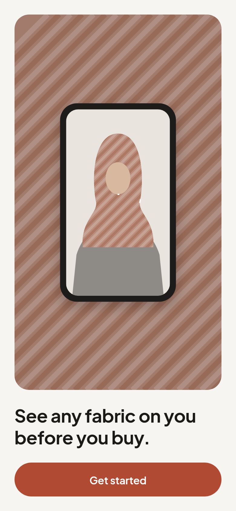
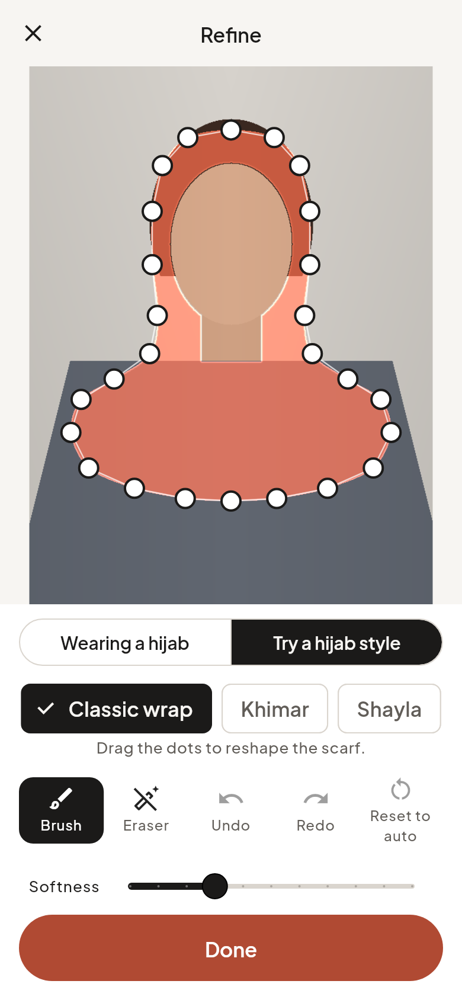
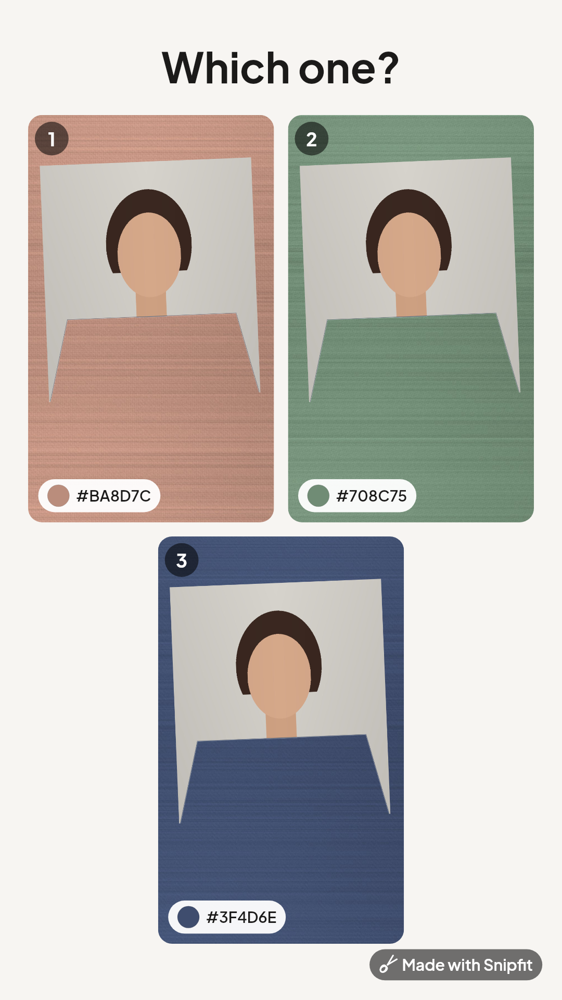
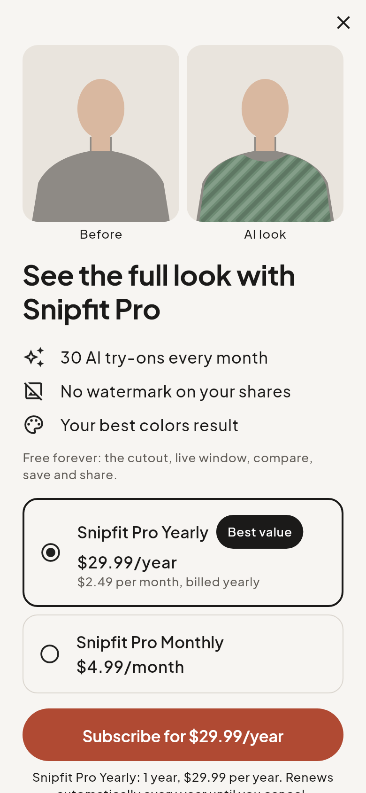

# Snipfit

See any fabric on you before you buy. Snipfit cuts the garment area (a top or a hijab) out of your photo **on the phone**, then holds that "window" over the live rear camera so real fabric in a store shows through around your face. Paid features (Snipfit Pro and AI credits) add an AI try-on that shows the full look.

The product spec is [SPEC.md](SPEC.md). What's built, what's verified and what's left is in **[docs/BUILD_REPORT.md](docs/BUILD_REPORT.md)**.

<p>





</p>

*Screens rendered from the real code by `test_screens/` (the portrait is synthetic; the cutout, compositing over the demo fabrics, color sampling and share renderers are the production pipeline).*

## Repository layout

| Path | What |
|---|---|
| `lib/` | Flutter app (Riverpod + go_router, feature-first: `onboarding`, `capture`, `cutout`, `live_window`, `compare`, `share`, `paywall`, `ai_tryon`, `settings`, `legal`) |
| `lib/features/cutout/mask/` | On-device mask pipeline (pure Dart, unit-tested): class-map upsampling, garment / worn-hijab / hijab-template windows, morphology, inward feathering, and the **no-skin invariant** |
| `android/`, `ios/` | Platform projects with `dev`/`prod` flavors and Snipfit's native modules (video encoder, share targets, tap-to-select segmenter) |
| `functions/` | Cloud Functions (TypeScript): RevenueCat webhook, credit ledger, AI try-on pipeline, safety checks, reporting, account deletion, 24-hour cleanup |
| `functions-python/` | Coverage service (MediaPipe multi-class segmenter) used to block AI results that show more skin |
| `firestore.rules`, `storage.rules`, `firestore.indexes.json`, `storage-lifecycle.json` | Backend security and retention |
| `hosting/public/` | Website: legal pages, account deletion page, invite landing, universal-link files |
| `assets/legal/` | Terms, Privacy Policy, Biometric Notice, AI Disclosure (**DRAFT, pending legal review**) |
| `docs/` | Build report, owner setup, compliance checklist, store review notes, listing copy, privacy forms, analytics, share kits |

## Run it

Requirements: Flutter 3.47.x (Dart 3.13), Xcode 26 for iOS, Android SDK 36.

```bash
flutter pub get
```

```bash
flutter run --flavor dev -t lib/main_dev.dart --dart-define-from-file=config/dev.json
```

With nothing configured, the app runs in **local-only mode**: the free cutout, live window, compare, save and share work fully offline with no account; accounts, purchases and AI try-on show as unavailable. Configure the backends with [docs/OWNER_SETUP.md](docs/OWNER_SETUP.md).

Production flavor:

```bash
flutter run --flavor prod -t lib/main_prod.dart --dart-define-from-file=config/prod.json
```

## Test

Flutter unit and widget tests (the script skips building OpenCV for the host, which the tests never call):

```bash
./tool/test.sh
```

Localization completeness:

```bash
python3 tool/check_l10n.py
```

Cloud Functions:

```bash
npm --prefix functions ci && npm --prefix functions test
```

Regenerate the screenshots in `docs/screenshots/`:

```bash
./tool/test.sh test_screens --update-goldens
```

## Other tools

- `tool/ios_configure.rb`: re-applies iOS flavors, schemes, entitlements and native sources to the Xcode project (idempotent; needs `gem install xcodeproj`).
- `tool/build_legal_pages.sh`: renders `assets/legal/*.md` into the hosted pages so the app and the website always say the same thing.

## CI

`.github/workflows/ci.yml` analyzes and tests everything, then builds and launches the dev flavor on an Android emulator and an iOS simulator. `release.yml` builds signed App Bundle / IPA (and can upload to Play internal testing and TestFlight). `backend.yml` deploys rules, functions and hosting. Secrets are listed at the top of each workflow.
