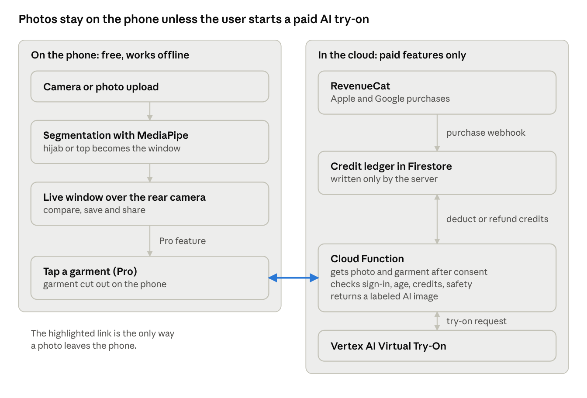

<!-- Source: Snipfit_Flutter_Build_Prompt.docx (Nov 4, 2026), converted to Markdown. This is the product spec the code follows; see docs/BUILD_REPORT.md for what is built and what is left. -->

# Snipfit Flutter Build Prompt

Nov 4, 2026 · @Amir

## How to use this prompt

Paste everything from \"Product brief\" through \"Build order\" into
your coding agent (Claude Code, Cursor or similar), or save it as
SPEC.md in the repo root and tell the agent to follow it. It is written
to the agent, in the second person.

It assumes these defaults, which you can change in \"Open decisions\" at
the end:

-   App name Snipfit, built in Flutter for iOS and Android from one
    codebase.

-   Firebase for auth, database and server functions; RevenueCat for
    subscriptions and credits.

-   Women\'s fashion mode launches first with Hijab mode alongside it;
    men\'s mode comes after launch.

-   The free cutout runs fully on the phone; AI features run through
    your own server and are paid.

Two honest caveats. First, this prompt has the agent draft your Terms
and Privacy Policy, but a lawyer should review them before launch; I am
not a lawyer. Second, the app is described as replacing the garment area
with fabric, never \"removing\" clothing. That wording and the
guardrails behind it matter: app stores remove apps that can be used to
undress people in photos.

## Product brief

You are a senior Flutter engineer and product designer. Build Snipfit, a
production-ready iOS and Android app that lets people see how a fabric
or garment color looks on them before buying, using a cutout of their
own photo held over the live camera.

**The core idea.** The user takes or uploads a photo of themselves. The
app masks the garment area (a hijab, or a top) and makes it a
transparent \"window.\" In a store, the user points the rear camera at a
scarf or shirt, and the real fabric shows through the window around
their face. It is the digital version of a viral trend where people cut
a garment out of a printed photo and hold it against fabric.

**Who it is for, in launch order:**

1.  Women\'s fashion mode, first: tops and dresses, for women who do and
    don\'t wear hijab.

2.  Hijab mode, alongside it: hijab-wearing women choosing scarf colors.

3.  Men\'s fashion mode, after launch: shirts and tops.

**Free versus paid:**

-   Free: the cutout, the live camera window, saving and sharing
    comparisons. This is the viral hook and costs nothing per use
    because it runs on the phone.

-   Paid (subscription or credits): AI try-on, where the user taps a
    garment seen through the camera and gets an image of themselves
    wearing it; and later, experimental live AR try-on.

**Product principles, in priority order:**

1.  Effortless: a first-time user gets a working cutout in under 60
    seconds, without reading anything.

2.  Shareable: every result is one tap away from a polished, branded
    share.

3.  Private by default: photos are processed on the device and never
    uploaded unless the user starts a paid AI feature and consents.

4.  Safe: the app never reveals skin or produces revealing imagery (see
    \"Safety guardrails\").

5.  Store-approved on the first submission: follow every rule in the
    compliance section.

**Success criteria for version 1:** a stable app on both stores, a
cutout that works on at least 9 of 10 typical selfies, a share flow
under 3 taps, a compliant paywall, and analytics on each step of the
funnel.

## Tech stack and architecture

Use one Flutter codebase with small native modules only where Flutter
has no good package. Keep everything free on the device; only paid AI
features touch the server.

**App (Flutter, latest stable, Dart 3):**

-   State and routing: Riverpod and go_router. Feature-first folders:
    onboarding, capture, cutout, live_window, share, paywall, ai_tryon,
    settings, legal.

-   Camera and photos: the camera plugin for front and rear cameras;
    image_picker for gallery uploads.

-   Free segmentation (on device): MediaPipe\'s multi-class selfie model
    (selfie_multiclass_256x256), which separates background, hair, body
    skin, face skin, clothes and accessories
    ([MediaPipe](https://developers.google.cn/mediapipe/solutions/vision/image_segmenter)).
    Start with the community package face_detection_tflite, which wraps
    this model for iOS and Android
    ([pub.dev](https://pub.dev/documentation/face_detection_tflite/latest/face_detection_tflite_native/SelfieSegmentation-class.html));
    fall back to tflite_flutter with the raw model if needed. Use the
    GPU on iOS and the CPU on Android, where GPU support is unreliable
    ([pub.dev](https://pub.dev/documentation/face_detection_tflite/4.6.4)).

-   Tap-to-select a garment (paid flow, rear camera): on Android,
    MediaPipe\'s Interactive Image Segmenter, which takes a tapped point
    and returns that object\'s mask
    ([Google](https://developers.google.com/edge/mediapipe/solutions/vision/interactive_segmenter/android));
    on iOS 17 and later, Apple Vision\'s foreground instance mask,
    picking the instance under the tap. Wrap both behind one Dart
    interface via platform channels.

-   Localization from day one: English, Arabic (full right-to-left
    layout), Turkish, Malay and Indonesian, using intl and ARB files.

-   Platform targets: iOS 16 minimum (tap-to-select needs iOS 17, so
    hide it below that), built with Xcode 26 and the iOS 26 SDK as Apple
    now requires
    ([Apple](https://www.developer.apple.com/news/upcoming-requirements/));
    Android minSdk 24 and the target API level Google Play currently
    requires.

**Backend (only for paid AI and accounts):**

-   Firebase: anonymous Auth by default, optional Sign in with Apple and
    Google; Firestore for the credit ledger and user settings; Cloud
    Functions (2nd gen) for all AI calls; Cloud Storage for temporary AI
    inputs with an automatic delete rule after 24 hours; App Check on
    every function.

-   AI try-on: Google\'s Vertex AI Virtual Try-On model, which takes one
    photo of a person and one of a garment and returns the person
    wearing it, 1 to 4 images per request ([Google
    Cloud](https://docs.cloud.google.com/vertex-ai/generative-ai/docs/image/generate-virtual-try-on-images)).
    Note its default limit of 50 requests per minute per project
    ([Google
    Cloud](https://cloud.google.com/vertex-ai/generative-ai/docs/models/imagen/virtual-try-on-preview-08-04?hl=en)),
    so queue requests and show progress. Keep the model behind a server
    interface so it can be swapped.

-   Never put any AI or cloud key in the app. The app calls your Cloud
    Function; the function checks App Check, auth, age confirmation,
    consent and credits, then calls Vertex AI.

**Payments and growth:**

-   RevenueCat (purchases_flutter, plus its paywall UI package) for
    subscriptions and consumable credit packs. Grant credits only from
    RevenueCat\'s server webhook into the Firestore ledger, never from
    the client.

-   PostHog (Flutter SDK) for product analytics, funnels and paywall
    experiments, with session replay and screen capture turned off so no
    camera frame or photo is ever recorded; Firebase Crashlytics for
    crashes; Firebase Remote Config for operational switches such as
    feature kill switches and the AI spending cap.

-   Sharing via share_plus; universal links and Android App Links on
    your own domain for invite links.

Snipfit architecture · free on-device path, paid cloud path

The free cutout, live window and sharing never leave the phone; the only
path to the server is the paid AI try-on, and only after the user
consents.

## Core free feature: cutout and live window

The free flow turns one photo into a reusable \"window\" and lays it
over the live rear camera. Segmentation runs once per photo; the live
view is only compositing, so it stays smooth on cheap Android phones.

1.  **Pick a mode:** Women or Hijab (Men after launch). Remember the
    choice; allow switching from the home screen.

2.  **Capture or upload:** front camera with a face-and-shoulders guide
    outline, or a gallery photo. Check for one face only, enough light
    and a frontal pose; give a one-line fix if a check fails (\"Move to
    brighter light\").

3.  **Build the window mask:**

    -   Hijab mode, wearing a hijab: hair, clothes and accessory classes
        in the head and neck region, never the face-skin class.

    -   Hijab mode, not wearing one: place a hijab-shaped template
        aligned to face landmarks instead of cutting the hair outline.
        Offer 3 to 5 named styles (for example Classic wrap, Khimar,
        Shayla) as editable vector shapes.

    -   Women and Men modes: the clothes class in the torso region only.

    -   The window may only cover clothing or the hijab template. It
        must never include face or body skin.

4.  **Refine:** finger brush and eraser, edge softness slider, undo and
    redo, and a \"Reset to auto\" button. Smooth edges automatically
    with a small dilate, erode and feather pass.

5.  **Live window:** full-screen rear camera with the cutout on top.
    Drag to move, pinch to resize and rotate, a lock button,
    tap-to-focus, exposure lock and a torch toggle for dim stores. Show
    a small tip to take a fresh selfie in the store for a fairer light
    match.

6.  **Capture and compare:** a shutter button saves the composite. Show
    the last 4 captures in a 2 by 2 compare grid, with a heart to pick a
    favorite and the sampled fabric color shown as a swatch and hex
    code.

7.  **Save:** keep results in the app\'s private storage. Ask for photo
    library access only when the user taps \"Save to Photos\" (add-only
    access on iOS).

**Acceptance criteria:**

-   A clean auto mask on at least 9 of 10 photos in a test set that
    covers light to dark skin tones, glasses, varied hijab styles and
    colors, and busy backgrounds.

-   Live window holds 30 frames per second or more on a mid-range
    Android phone from 2022.

-   No raw transparent cutout is ever exported; exports are always the
    finished composite.

-   Everything in this section works offline, with no account.

## Onboarding and instructions

Onboarding must get the user to their first working cutout in under 60
seconds, collect legal consent properly, and teach the store trick by
doing it, not by reading.

1.  **Hook screen:** a 5-second looping animation of the paper-cutout
    trick turning digital: a printed photo with the scarf cut out, held
    over fabric, then the same thing on a phone. One line: \"See any
    fabric on you before you buy.\" One button: \"Get started.\"

2.  **Age screen:** ask for birth year with a neutral picker that does
    not hint at a required age. Block anyone under 13 with a friendly
    message. Store an isAdult flag for 18 and over; AI features require
    it.

3.  **Terms screen (clickwrap):** a short plain-language summary of 3
    bullets, links to the full Terms of Use and Privacy Policy, and an
    unticked checkbox, \"I agree to the Terms of Use and Privacy
    Policy.\" The \"Continue\" button stays disabled until it is ticked.
    Log the version and timestamp of what they accepted.

4.  **Mode picker:** two large cards at launch (Women, Hijab), plus a
    Men card behind a feature flag, each with a sample image.

5.  **Camera explainer:** one screen saying photos are processed on the
    phone and are not uploaded. Its button says \"Continue\" (never
    \"Allow\") and then triggers the system camera prompt. If denied,
    show a gentle screen with a button to open Settings and an option to
    upload a photo instead.

6.  **Guided first capture:** coach marks on the face guide, an
    automatic cutout, and a short celebration when it works (\"Your
    window is ready\").

7.  **Practice live window:** a 3-step overlay on the rear camera:
    \"Point at any fabric,\" \"Drag your photo onto it,\" \"Snap to
    compare.\" Offer a built-in demo fabric image for users who are not
    in a store yet.

8.  **Soft paywall:** only after the first successful compare, show the
    paywall once, with a clearly visible close button. Never block the
    free features behind it.

**Rules:**

-   Every screen except Age and Terms is skippable, and \"How it works\"
    replays the tutorial from Settings.

-   Mode-specific tips: Hijab mode suggests a plain-colored hijab or
    tying back loose ends; Women and Men modes suggest a plain, fitted
    top for a cleaner cutout.

-   Ask for notification permission only later, after the user saves a
    first comparison, and explain why (for example, \"Get a reminder
    when your try-on is ready\").

-   Track each step as an analytics event so drop-offs are visible.

## Share to social

Sharing is the growth engine, so a finished share must take 3 taps or
fewer from any result, and the default output should look like content
people already post.

**Share formats (generated on the device):**

-   **Reveal video, the default:** a 6 to 8 second vertical 9:16 MP4
    that replays the trend: the photo appears, a scissors animation
    traces the cutout, then the real fabric shows through, ending on the
    result. Include an optional royalty-free sound from a licensed
    library; never bundle copyrighted music.

-   **Compare collage:** 2 to 4 captures in a grid with a \"Which one?\"
    title, in 9:16 and 1:1.

-   **Single result:** the composite with its fabric swatch and hex
    code.

**Branding:** a small, tasteful \"Made with Snipfit\" mark in a corner
of every free export. Removing it is a Pro perk. Never cover the face or
the fabric with it.

**Share targets:**

-   One share sheet with big buttons for Instagram Stories, TikTok,
    Snapchat and WhatsApp, plus \"More\" for the system sheet via
    share_plus.

-   Use each platform\'s official sharing kit where it exists (Meta\'s
    Stories sharing, TikTok\'s Share Kit, Snap\'s Creative Kit), each of
    which needs its own developer registration and app ID. Fall back to
    the system sheet when a kit is unavailable.

-   Add the caption text and an invite link to the clipboard with a
    one-line notice, so users can paste it.

**Privacy in sharing:**

-   Strip all location and camera metadata from every export.

-   If the photo came from \"Try on someone else\" mode, remind the user
    to share only with that person\'s permission.

**Invite links:** each user gets a link on your own domain that opens
the app via universal links and App Links, or the App Store custom
product page for that mode if it is not installed.

**Do not:**

-   Require sharing, rating or reviewing to unlock any feature or
    reward; both stores prohibit that.

-   Ask for an App Store review except through the native in-app review
    prompt, and only after a positive moment such as a saved favorite.

A \"friends vote\" link that shows options on a web page is a good later
feature, but it uploads photos, so ship it only with explicit opt-in
consent and automatic deletion after 7 days.

## Paywall and monetization

Sell one Pro subscription plus optional AI credit packs, and make the
paywall persuasive but fully transparent: store reviewers reject unclear
subscription screens, and regulators punish them.

**Products (prices are set as RevenueCat offerings and tested with
PostHog experiments; placeholders shown):**

  -------------------------------------------------------------------------
  Product        Type            Placeholder     Includes
                                 price           
  -------------- --------------- --------------- --------------------------
  Snipfit Pro    Auto-renewing   \$29.99 per     30 AI try-ons per month,
  Yearly         subscription    year            no watermark, \"Your best
  (default,                                      colors\" result, live AR
  highlighted)                                   when released

  Snipfit Pro    Auto-renewing   \$4.99 per      Same as yearly
  Monthly        subscription    month           

  20 AI credits  Consumable      \$4.99          20 extra AI try-ons, for
                                                 free or Pro users
  -------------------------------------------------------------------------

Use a direct purchase by default rather than a free trial: in Lifestyle
apps, trial users end up worth about 21% less than direct buyers
([Adapty](https://adapty.io/blog/lifestyle-app-subscription-benchmarks/)).
Keep the trial as a PostHog experiment.

**Paywall layout, top to bottom:**

1.  A visible close button from the first frame, with no delay.

2.  Hero: a short before and after of an AI try-on in the user\'s
    current mode.

3.  Three benefit lines, each with an icon.

4.  Plan selector with yearly preselected and its monthly equivalent
    shown.

5.  The purchase button, labeled with the action and price (\"Subscribe
    for \$29.99/year\").

6.  Directly under the button, in readable type: plan name, length,
    price per period, that it renews automatically until cancelled, and
    how to cancel.

7.  Links to Terms of Use, Privacy Policy and Restore Purchases.

**Store rules to meet exactly:**

-   Apple 3.1.2(c): before purchase, show the subscription title, length
    and price, with working links to the privacy policy and Terms of Use
    ([Apple
    forums](https://origin-devforums.apple.com/forums/profile/EuMarkus)).
    Also put both links in App Store Connect metadata ([Apple
    forums](https://developer.apple.com/forums/thread/807082)).

-   Google Play: if a trial or intro offer runs, state its duration,
    price, what is included, when it converts to paid, and how to cancel
    ([Android
    Developers](https://android-developers.googleblog.com/2020/04/building-user-trust-through-more.html?hl=hu_HU)).
    Clearly separate free from paid features
    ([TechRadar](https://www.techradar.com/news/google-launches-fresh-attack-on-android-fleeceware)),
    and give an easy route to cancel, such as a link to Google Play\'s
    subscription center
    ([Newly](https://newly.app/how-to/add-a-paywall)).

-   Load every price and period from the store through RevenueCat,
    localized. Never hardcode a price string.

-   Settings must include Manage Subscription, Restore Purchases and the
    current credit balance.

**Credits logic (server-side):**

-   The Firestore ledger is the source of truth, written only by Cloud
    Functions and the RevenueCat webhook.

-   Deduct a credit only when a generation succeeds; refund it
    automatically on failure or a safety block.

-   Consumable credits cannot be restored by Apple, so prompt users to
    sign in with Apple or Google to keep credits across devices.

-   Enforce a per-user rate limit and a global daily spending cap in
    Remote Config, so a viral spike cannot run up a surprise AI bill.

**Never:** fake countdown timers, a hidden or delayed close button, a
preselected trial that hides the renewal price, or a paywall that blocks
the free cutout.

## Paid AI try-on: tap a garment, see it on you

This is the first paid feature: in a store, the user taps a garment
through the rear camera and, after a short wait, sees an AI image of
themselves wearing it. Position it as showing the full look and drape,
while the free cutout shows the true color.

**Flow:**

1.  **Gate:** requires an adult account (isAdult), Pro or a credit, and
    a one-time AI consent screen (below).

2.  **Try-on photo:** the user sets one reference photo of themselves,
    upper body or full body, fully clothed, one person, good light.
    Store it on the device; upload it only for each generation.

3.  **Tap the garment:** rear camera; the user taps the item on a rack,
    hanger or mannequin. The on-device tap segmenter returns its mask.
    Show the cropped garment on a plain background with \"Is this the
    item?\", plus brush adjust and retake.

4.  **Generate:** the app uploads the reference photo and the garment
    crop to your Cloud Function, which runs the checks in \"Safety
    guardrails,\" then calls the try-on model. Show an honest progress
    screen; generation can take a minute or more through some providers
    ([Pixazo](https://www.pixazo.ai/blog/introducing-google-virtual-try-on-api-on-pixazo-api)),
    so offer a push notification when it is ready.

5.  **Result:** show 1 or 2 images side by side with the free cutout,
    labeled \"True color\" and \"AI look.\" Every AI image carries a
    visible \"AI-generated\" label and AI provenance metadata. Save and
    share work as usual.

**AI consent screen (shown once, re-shown if anything changes):**

-   Plain words: \"To create this preview, your photo and the garment
    photo are sent to our server and to Google\'s AI service. They are
    deleted within 24 hours.\"

-   Confirm which training and retention terms actually apply under your
    Google Cloud agreement, and state only what is true.

-   An unticked checkbox, \"I agree, and I confirm this photo is of me
    or someone who gave permission.\" Log consent with a timestamp.

**Model and prompting rules:**

-   Primary model: Vertex AI Virtual Try-On, which takes a person photo
    plus a garment photo ([Google
    Cloud](https://docs.cloud.google.com/vertex-ai/generative-ai/docs/image/generate-virtual-try-on-images)).
    Test hijabs specifically; if it handles them poorly, fall back to a
    Gemini image-editing model with a fixed instruction.

-   Users never type prompts. All instructions are fixed on the server:
    keep the face, body and pose unchanged; replace only the target
    garment; the result must cover at least as much as the original
    clothing.

-   Budget about \$0.06 per image as a planning figure
    ([Pixazo](https://www.pixazo.ai/blog/introducing-google-virtual-try-on-api-on-pixazo-api))
    and confirm current Google Cloud pricing before launch.

**Acceptance criteria:** credits are deducted only on success; a failed
or blocked request refunds automatically; inputs are deleted from
storage within 24 hours; the feature is hidden on devices that cannot
run the tap segmenter, with a \"choose from gallery\" alternative.

## Live AR try-on (experimental, later)

True generative AI cannot run on every camera frame yet, so live try-on
needs real-time AR techniques instead. Build it after launch, behind a
Remote Config flag, labeled \"Beta,\" for Pro users only.

**Path A, shirts and tops: Snap Camera Kit with Garment Transfer.**

-   Snap\'s Garment Transfer takes an image of an upper-body garment and
    transfers it onto a person in live video, choosing full real-time or
    tap-to-run depending on the device
    ([Snap](https://developers.snap.com/lens-studio/features/try-on/garment-transfer)).

-   Its documented limits: one person in frame, and close-fit long- or
    short-sleeve shirts
    ([Snap](https://developers.snap.com/lens-studio/4.55.1/references/templates/object/Try-On/garment-transfer?lang=en-US)).
    It does not cover hijabs.

-   Camera Kit lets apps run Lens Studio Lenses inside their own app
    without users needing Snapchat
    ([Snap](https://ar.snap.com/blog/snap-camera-kit-ar-sdk)). Integrate
    its native iOS and Android SDKs through a Flutter platform view.

-   Before building, confirm three things: Camera Kit access approval
    for this app; that the app can pass the user\'s captured garment
    image into the Lens at runtime; and Snap\'s terms for user-captured
    garments.

**Path B, hijabs: on-device live recolor.**

-   Run the multi-class segmenter on the front camera every frame, find
    the hijab region (hair, clothes and accessory classes around the
    head), and recolor or retexture it with the fabric color sampled
    from a rear-camera capture.

-   This is the hijab equivalent of live try-on and needs no server.
    Target 24 frames per second or more, lowering the model\'s input
    size on slow phones.

**Rules for both paths:**

-   Only replace or recolor garments; never make clothing transparent or
    reveal what is under it.

-   Do not list live AR as a paywall benefit until it has shipped and
    works reliably; advertising unavailable features invites rejection
    and refund disputes. Until then, the Pro table\'s \"live AR when
    released\" line stays hidden.

## Safety guardrails

Snipfit only ever replaces or recolors clothing with fabric or another
garment; it must be impossible to use it to reveal skin or make sexual
imagery. Treat every rule here as a hard requirement, because both
stores remove apps that can be misused this way.

**Product-level rules:**

-   The cutout window may only cover clothing classes or a hijab
    template, never face or body skin.

-   Exports are always finished composites; never offer a transparent
    cutout file.

-   AI instructions are fixed on the server. Users cannot type prompts,
    upload a mask, or choose what to remove.

-   Every AI result must cover at least as much of the body as the
    original clothing. Check this automatically by comparing the clothed
    area before and after, and block results that reduce it.

-   No swimwear, underwear or lingerie as garments or as the reference
    outfit. Google\'s own try-on excludes these categories ([Google
    Labs](https://labs.google/doppl)).

-   Never use words like \"remove clothes\" or \"undress\" anywhere: app
    copy, store listing, ads or code comments.

**Content checks on the server (inputs and outputs):**

-   Run an image safety classifier (for example Google Cloud Vision
    SafeSearch, plus the generation model\'s own safety filters) on the
    person photo, the garment crop and every result.

-   Block anything flagged as adult, racy or violent, refund the credit,
    and show a neutral message.

-   Google Play requires generative AI apps to prevent restricted
    content ([Google
    Play](https://support.google.com/googleplay/android-developer/answer/13985936?hl=en)),
    which includes sexual content
    ([Gizchina](https://gizchina.com/?p=459723)).

**Minors and other people:**

-   The app is for ages 13 and up; AI features are for adults only,
    based on the age screen.

-   Terms forbid uploading photos of anyone under 18 or anyone who has
    not given permission. Google\'s try-on applies the same two rules
    ([Google Shopping
    Help](https://support.google.com/googleshopping/answer/16253678?hl=en)).

-   \"Try on someone else\" mode requires the user to confirm they have
    that person\'s permission each time.

**Reporting and labeling:**

-   Every AI result has a \"Report\" button that works without leaving
    the app, as Google Play requires ([Google
    Play](https://support.google.com/googleplay/android-developer/answer/13985936)).
    Reports go to a moderation queue; use them to tune filters.

-   Every AI image carries a visible \"AI-generated\" label and
    machine-readable provenance metadata. The EU AI Act\'s labeling
    duties for AI-made images of real people have applied since August
    2, 2026 ([Baker
    McKenzie](https://connectontech.bakermckenzie.com/new-eu-guidance-on-ai-transparency-what-should-companies-be-doing-from-2-august-2026)),
    even when nobody intends to deceive ([Greenberg
    Traurig](https://www.gtlaw.com/en/insights/2026/6/deepfakes-chatbots-ai-generated-text-european-commission-details-transparency-obligations-under-the-ai-act)).

**Abuse handling:** rate limits per user and device, automatic
suspension after repeated blocked requests, and minimal logs (no images)
for investigations. Ask your lawyer about legal reporting duties if
illegal content involving a child is ever detected; US providers have
mandatory reporting obligations.

## Legal, consent and privacy

Draft the legal documents and build the consent flows below, but mark
every document \"DRAFT, pending legal review.\" The owner will have a
lawyer review them before launch. Host each document at a stable URL on
the app\'s website and show it in the app.

**Biometric privacy is the biggest legal risk.** Virtual try-on tools
have drawn a wave of class actions under Illinois\' Biometric
Information Privacy Act, against brands including Louis Vuitton and
Estée Lauder ([Duane
Morris](https://blogs.duanemorris.com/classactiondefense/author/kabonner))
and, in 2025, MAC Cosmetics
([RetailBoss](https://retailboss.co/mac-cosmetics-faces-biometric-privacy-lawsuit-illinois-virtual-try-on-tech)).
In one case, a court found a pop-up notice with a privacy link
insufficient, because users could use the tool without ever seeing the
terms ([Duane
Morris](https://blogs.duanemorris.com/classactiondefense/?p=180)). So:

-   Before the first face processing, show a biometric notice and get
    explicit consent with an unticked checkbox, for all users, not only
    in Illinois.

-   Publish a written retention and deletion policy: face landmarks and
    masks computed on the device are used only in memory and never
    stored or sent; AI inputs are deleted within 24 hours.

-   Never sell, rent or share face data, and never use it to identify
    anyone.

**Documents to draft:**

1.  **Terms of Use (EULA):** eligibility (13 and up, AI features 18 and
    up); acceptable use (no photos of minors, no photos of others
    without permission, no sexual or harassing content); a limited
    license to user photos only to run the service; a clear statement
    that AI previews are approximations and colors may differ;
    subscription and credit terms that point to Apple\'s and Google\'s
    billing and cancellation; warranty disclaimer, limitation of
    liability and indemnity; suspension for abuse; governing law and
    dispute resolution, with arbitration and class-action waiver left
    for the lawyer to decide; how changes are announced.

2.  **Privacy Policy:** what stays on the device versus what is sent;
    each processor named (Google Cloud and Vertex AI, Firebase,
    RevenueCat, PostHog); purposes; retention periods; user rights under
    GDPR in the EU and UK and under California\'s CCPA; no data sales;
    no users under 13; international transfers; security; contact email.

3.  **Biometric Notice:** a short standalone page, linked from the
    consent screen and the Privacy Policy.

4.  **AI Disclosure:** what is sent, to whom, why, and how long it is
    kept (also shown in-app at the AI consent step).

**Consent records:** store each acceptance (terms version, biometric
consent, AI consent, timestamp, app version, locale) in Firestore, for
anonymous users too. Ask again whenever a document changes materially.
Settings must let users withdraw AI consent, which turns AI features
off.

**Subscriptions law:** the paywall disclosures in this spec also serve
US auto-renewal laws such as the federal Restore Online Shoppers\'
Confidence Act and California\'s Automatic Renewal Law ([Conduct
Atlas](https://conductatlas.com/platform/google-play-store/google-play-terms/subscription-auto-renewal-and-trial-cancellation/)).

**Owner checklist (outside the code):** form an LLC before launch so the
business carries the liability; ask an insurance broker about tech
errors and omissions and cyber coverage; run a trademark search for
\"Snipfit\"; use only licensed fonts, sounds and stock images.

## App Store and Google Play compliance checklist

Treat this as a release gate: every box must be checked before the first
submission, and re-checked whenever a feature is added.

**Apple App Store:**

-   [ ] Third-party AI (Guideline 5.1.2(i)): before any photo reaches
    the server, an in-app screen says what is sent, names the provider,
    states the purpose, and gets an explicit opt-in. A privacy-policy
    line alone fails review
    ([Stora](https://stora.sh/blog/2026-05-06-apple-ai-consent-rule-5-1-2-i-implementation-guide)),
    and any AI call that fires before consent is rejected.

-   [ ] Subscription paywall meets 3.1.2(c), and Terms and Privacy links
    are in App Store Connect metadata (see \"Paywall\").

-   [ ] In-app account deletion, easy to find in Settings, if any
    account can be created
    ([Apple](https://developer.apple.com/help/app-review/guideline-reference/5-1-1-account-deletion)).

-   [ ] Sign in with Apple offered alongside Google sign-in.

-   [ ] Privacy manifest with approved reasons for required-reason APIs,
    including those used by third-party SDKs
    ([Apple](https://developer-mdn.apple.com/news/upcoming-requirements/));
    privacy nutrition labels match actual behavior.

-   [ ] Camera and \"add to Photos\" purpose strings in plain words;
    photo selection through the system picker so no full library
    permission is needed.

-   [ ] Built with Xcode 26 and the iOS 26 SDK.

-   [ ] No hidden or server-gated features left undescribed: Apple
    requires new features, including flagged ones, to be explained in
    the review notes ([Newly](https://newly.app/how-to/add-a-paywall)).

-   [ ] Review notes include how to test the AI flow, a built-in demo
    fabric for testing away from a store, and a short description of the
    safety system.

-   [ ] Age rating questionnaire answered honestly, including AI image
    generation.

**Google Play:**

-   [ ] In-app \"Report\" on AI results and filters that prevent
    restricted content ([Google
    Play](https://support.google.com/googleplay/android-developer/answer/13985936)).

-   [ ] Account deletion in the app plus a public web page for deletion
    requests, with that URL entered in the Data safety form ([Google
    Play](https://support.google.com/googleplay/android-developer/answer/13327111?hl=en-AU)).

-   [ ] Data safety form matches actual behavior, including the AI
    upload and its 24-hour deletion.

-   [ ] Android Photo Picker instead of broad photo permissions, since
    Play limits photo access to purposes directly tied to app features
    ([National
    Herald](https://www.nationalheraldindia.com/science-tech/google-cracks-down-on-offensive-ai-apps-disruptive-notifications)).

-   [ ] Target audience declared as 13 and up, not children; content
    rating questionnaire completed.

-   [ ] Current required target API level; Android App Bundle.

-   [ ] A 14-day closed test with at least 12 testers, required for new
    personal developer accounts
    ([PrimeTestLab](https://primetestlab.com/blog/google-play-publishing-requirements-2026)).
    Start it early.

**Both stores:**

-   [ ] Privacy Policy URL set in both consoles; Terms reachable in-app
    without an account.

-   [ ] Screenshots show the real app and clothed results only; no
    listing copy that implies removing clothing.

-   [ ] No feature, reward or credit requires sharing, rating or
    reviewing.

-   [ ] Custom product pages and store listings per mode (Women, Hijab,
    and later Men) with matching screenshots.

## UI and design system

The interface should feel calm, premium and one-handed, and stay
visually neutral around the camera so it never tints how a fabric color
is judged.

**Visual language:**

-   Neutral chrome: warm off-white and near-black surfaces with mid-gray
    controls over the camera. Use one accent color for primary actions
    only, never around the live window.

-   Type: a friendly geometric sans for Latin text plus a matching
    Arabic family with good weights, both under open licenses (for
    example Plus Jakarta Sans with IBM Plex Sans Arabic). Use a 5-step
    scale.

-   Shapes: 16-point corner radius on cards and sheets, pill-shaped
    primary buttons 56 points tall, 8-point spacing grid.

-   Motion: short, purposeful transitions (200 to 300 milliseconds), a
    satisfying \"snip\" animation when a cutout completes, light haptics
    on capture and save. Respect the system\'s reduce-motion setting.

-   Full light and dark themes, and mirrored layouts for right-to-left
    languages.

**Key screens:**

1.  Home: mode switcher at the top, one large \"New window\" button,
    recent windows below, a credits and Pro badge.

2.  Capture: full-screen camera, face guide, shutter, upload and flip
    buttons in the thumb zone.

3.  Refine: the photo with the window tinted, brush and eraser, softness
    slider, \"Done.\"

4.  Live window: edge-to-edge rear camera, the floating cutout, and a
    bottom bar with lock, torch, shutter and compare.

5.  Compare: 2 by 2 grid, favorite hearts, swatches, a large \"Share\"
    button.

6.  Share sheet, Paywall, AI Try-on progress and result, Settings, and
    Legal.

**Usability rules:**

-   Every primary control sits in the bottom third of the screen for
    one-handed use in a store aisle.

-   Tap targets of at least 48 by 48 points; contrast of at least 4.5 to
    1 for text.

-   Screen-reader labels on every control; text scales with the system
    font size without breaking layouts.

-   At most one line of instruction on any camera screen; teach with
    motion and coach marks, not paragraphs.

-   Every empty state has an illustration and one action (\"Make your
    first window\"). Use original illustrations only.

## Analytics, testing and acceptance criteria

Measure every step from install to purchase without ever logging images
or personal details, and hold each release to fixed quality bars.

**Funnel events (no images, names or emails in any event):**

-   Onboarding: onboarding_step_viewed (step), age_confirmed,
    terms_accepted, mode_selected (mode).

-   Core: capture_started (camera or upload), cutout_completed (auto
    quality score), refine_used, live_window_opened, compare_saved.

-   Growth: share_opened (format), share_completed (target),
    invite_opened.

-   Money: paywall_viewed (trigger), purchase_started,
    purchase_completed (product), restore_tapped.

-   AI: ai_consent_given, ai_tryon_requested, then ai_tryon_succeeded,
    ai_tryon_blocked or ai_tryon_failed, and report_submitted.

Ask EU and UK users for consent before non-essential analytics. Do not
track users across other companies\' apps; if an ads attribution SDK is
added later, it needs Apple\'s tracking permission prompt. Choose
PostHog\'s EU or US cloud region deliberately and name it in the Privacy
Policy.

**Testing:**

-   Unit tests for mask building, credit logic and consent gating;
    widget tests for onboarding and the paywall; integration tests for
    purchase, restore and AI flows using store sandbox accounts.

-   A segmentation test set of about 200 photos from consenting adults
    (or properly licensed images) that covers light to dark skin tones,
    many hijab styles and colors, glasses and busy backgrounds. Never
    scrape faces from the web.

-   Safety tests using vendor-provided or synthetic adult-content test
    images to confirm blocking and refunds. Never collect images of
    minors for testing.

-   Device matrix: a recent iPhone, an iPhone at the minimum supported
    iOS, a flagship Android, and a low-cost Android phone with 4 GB of
    RAM.

**Release bars:**

  -----------------------------------------------------------------------
  Measure                           Target
  --------------------------------- -------------------------------------
  Cold start                        Under 2 seconds on a mid-range phone

  Auto cutout time                  Under 1.5 seconds per photo

  Live window frame rate            30 frames per second or more

  Clean auto masks on the test set  90% or more

  Crash-free sessions               99.5% or more

  Install size                      Under 80 MB

  Share flow                        3 taps or fewer
  -----------------------------------------------------------------------

## Build order

Work one phase at a time. At the end of each phase, run the app on both
an iPhone and an Android phone, then report what was built, what is
left, and any decision you need from the owner before continuing.

1.  **Setup:** Flutter project with dev and production flavors, Firebase
    projects for each, RevenueCat sandbox, local iOS builds and
    debugging on the owner\'s Mac with Xcode 26, cloud CI for release
    builds, analytics and crash reporting, and placeholder legal pages.
    Done when both apps build and launch from CI.

2.  **Free core:** capture, segmentation, hijab templates, refine, live
    window, compare and save, fully offline. Done when the test set
    reaches 90% clean masks and the live window holds 30 frames per
    second on the low-cost Android test phone.

3.  **Onboarding and legal:** age screen, terms clickwrap, biometric
    consent, camera explainer, guided first capture, Settings (deletion,
    restore, consent withdrawal, legal links). Start Google Play\'s
    14-day closed test with 12 testers at the end of this phase.

4.  **Sharing:** reveal video, collages, watermark, platform share kits,
    invite links. Done when any result shares in 3 taps or fewer.

5.  **Paywall and Pro:** RevenueCat products, compliant paywall, credit
    ledger and webhook, Remote Config price tests. Done when purchase,
    renewal, restore and refund paths pass in both sandboxes.

6.  **AI try-on:** tap-to-select garment, Cloud Function, AI consent,
    Vertex AI integration, safety checks, coverage check, labeling,
    in-app reporting, automatic refunds. Done when all safety tests pass
    and inputs are deleted within 24 hours.

7.  **Store preparation:** complete the compliance checklist, per-mode
    screenshots and custom product pages, review notes, and the demo
    fabric. Submit to both stores, with Women\'s mode as the default
    listing and Hijab mode on its own custom product page.

8.  **After launch:** hijab live recolor (Path B), then Snap Camera Kit
    garment transfer (Path A) once access is approved, then the
    friends-vote link and more languages.

## Open decisions for Amir

The spec runs on the defaults below; change any of them here before
handing it to the agent, and it will build accordingly.

  ------------------------------------------------------------------------
  Decision     Default in this spec          Why it matters
  ------------ ----------------------------- -----------------------------
  Legal entity An LLC in California          Names the party in the Terms
  and                                        and the law that applies
  governing                                  
  law                                        

  Minimum age  13 and up, AI features 18 and 18 and up for everything is
  for the      up                            legally simpler but shrinks
  whole app                                  the teen audience

  Accounts     Anonymous by default,         Required sign-in adds
               optional Apple or Google      friction but protects credits
               sign-in                       across devices

  Pricing      \$29.99 per year, \$4.99 per  Sets revenue per user and AI
               month, 20 credits for \$4.99, margin
               no free trial                 

  Free AI      None                          One free try-on helps
  sample                                     conversion but costs money at
                                             viral scale

  Launch       US, Turkey, Malaysia,         Drives localization work and
  markets and  Indonesia and the Gulf;       store listings
  languages    English, Arabic, Turkish,     
               Malay, Indonesian             

  Modes at     Primarily women then Hijab    Men\'s mode has the least
  launch       since women as a whole that   evidence of demand
               dont wear hijab is a major    
               market too; Men added after   
               launch                        

  Hijab        Classic wrap, Khimar, Shayla  Hijabi testers should confirm
  template                                   the right set
  styles                                     

  Mac for iOS  I have a mac with 64gb so i   A local Mac speeds up
  builds       dont mind testing it on my    debugging on iPhone
               mac the ios build             

  Analytics    Use posthog instead           Alternatives like PostHog
  tool                                       give deeper funnels
  ------------------------------------------------------------------------
